# 电商用户购买行为预测系统

基于 Olist 巴西电商数据集，预测「用户未来 30 天是否购买」并推荐「最可能购买的商品品类」。包含数据清洗、特征工程、四种深度模型训练与对比、Flask + Vue 前后端、单用户与批量预测。

> 4 个模型（LSTM / GRU / MLP Fusion / Transformer）同口径对比，全部指标可复现，见 `results/model_comparison.csv`。

**在线试跑：** [浏览器内实时推理](https://zhangyiwei-portfolio.app.workbuddy.host/demo/?sharecode=EMBLO7P56G) — 权重在浏览器里直接前向传播，无需后端；与 PyTorch 在 312 条测试样本上逐条比对，312/312 一致。

---

## 实测结果

测试集（类别不平衡，正样本约 17%）：

| 模型 | Accuracy | Precision | Recall | F1 | ROC-AUC | 品类 Top-3 命中 |
|---|---|---|---|---|---|---|
| **Transformer** | **0.551** | 0.527 | 0.837 | **0.646** | 0.572 | 0.373 |
| MLP Fusion | 0.490 | 0.490 | 0.948 | 0.646 | 0.580 | 0.366 |
| GRU | 0.532 | 0.514 | 0.850 | 0.640 | **0.585** | **0.379** |
| LSTM | 0.481 | 0.485 | **0.961** | 0.645 | 0.587 | 0.373 |

### 关于这组数字，需要说明三点

1. **ROC-AUC 只有 0.57–0.59，接近随机。** 这是真实结果，不是跑错了。Olist 数据集的用户复购极其稀疏（大量用户一生只下一单），静态画像 + 30 天订单时序能提供的信号很弱。四模型 AUC 全部落在 0.57–0.59 这个窄区间，本身就是「特征上限到了」的证据。
2. **Recall 高、Precision 低是有意为之。** 训练集正样本占比低，模型在最大化 F1 的阈值上会倒向多报，所以 recall 0.84–0.96、precision 0.48–0.53。业务含义是「宁可多推，不可漏推」。
3. **品类推荐 Top-3 命中 0.37。** 9 个品类里盲猜是 0.33，所以品类任务的增量非常有限，同样是数据问题。

结论写在论文里：这套系统能跑通完整链路，但预测能力受限于公开数据集本身，进一步优化应该换数据源（引入行为序列、商品共现），而不是继续调模型。

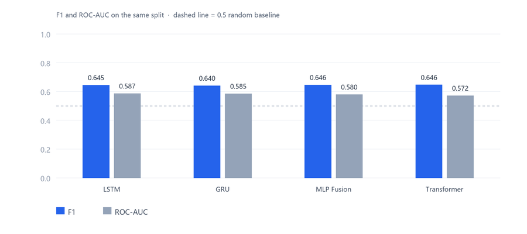

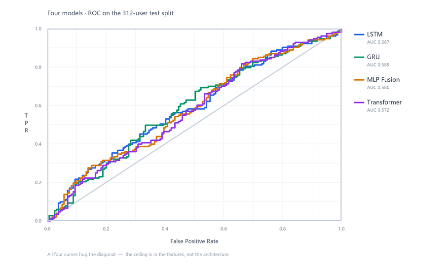

<details>
<summary>单模型细节（混淆矩阵 / 训练曲线 / 特征重要性）</summary>

**混淆矩阵**

| LSTM | GRU |
|---|---|
| 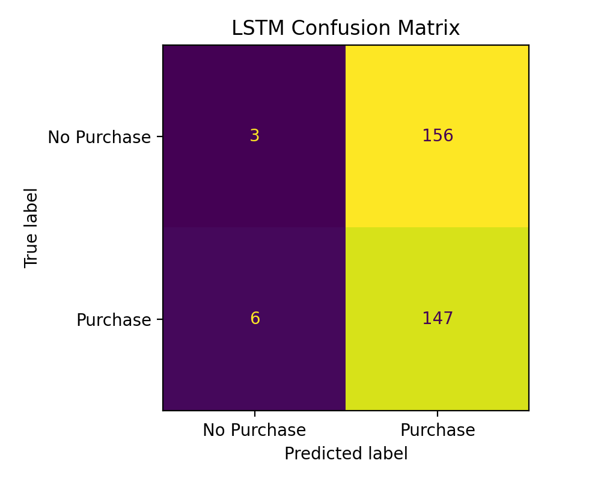 | 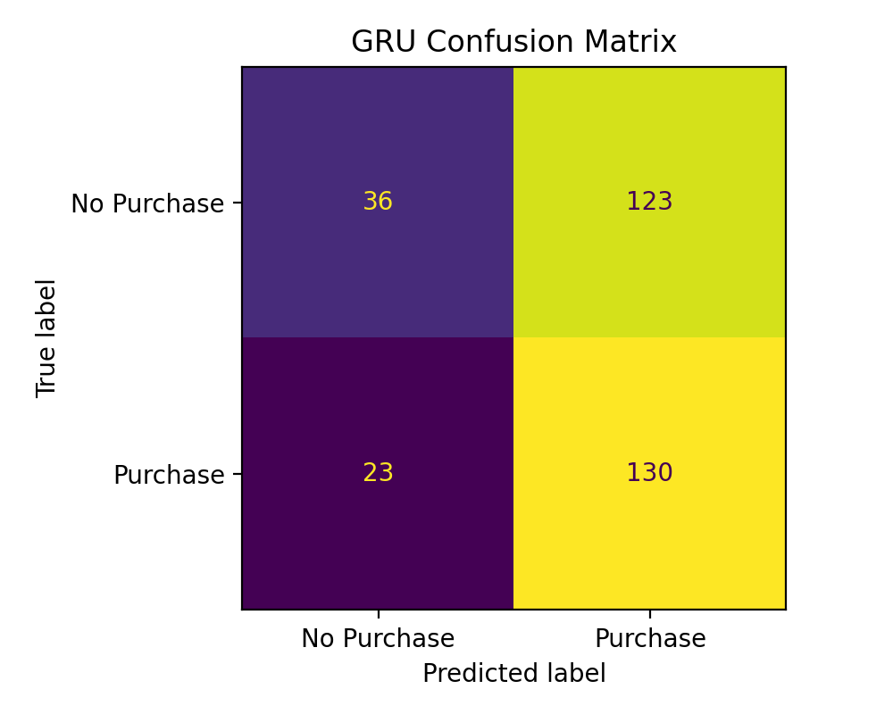 |
| 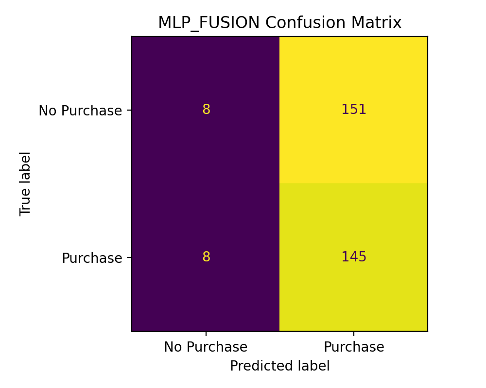 | 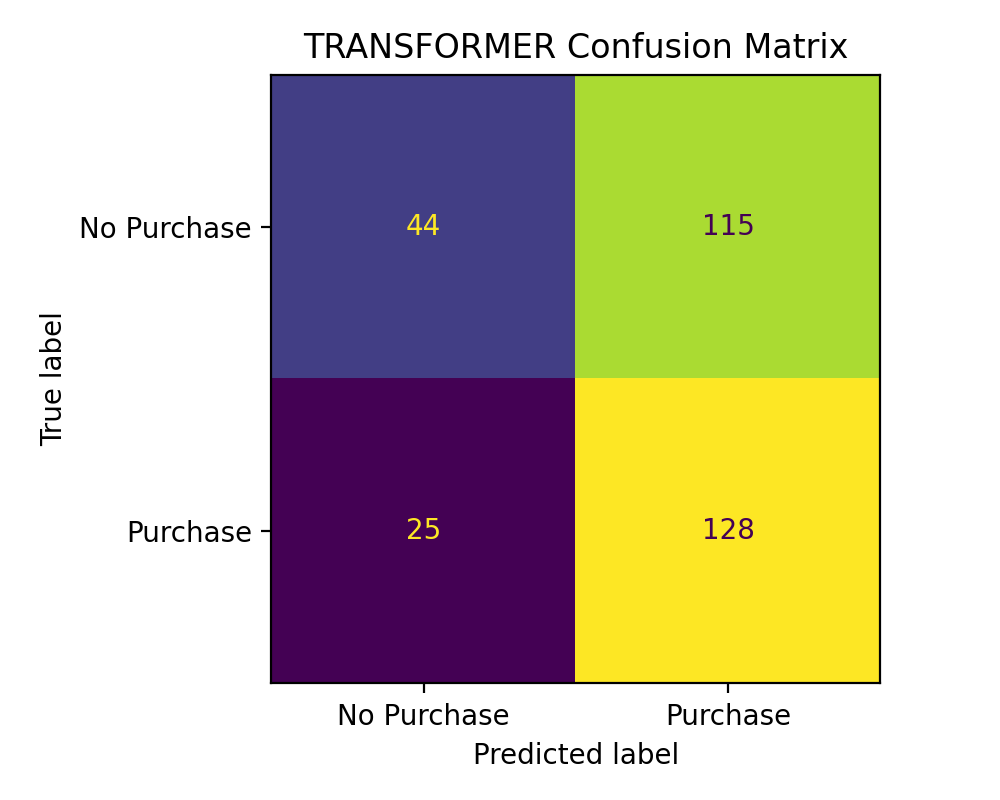 |

**训练曲线**

| LSTM | GRU |
|---|---|
| 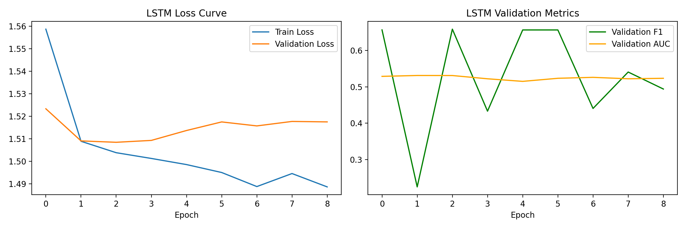 | 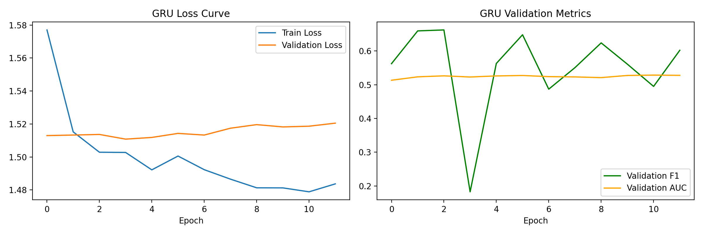 |
| 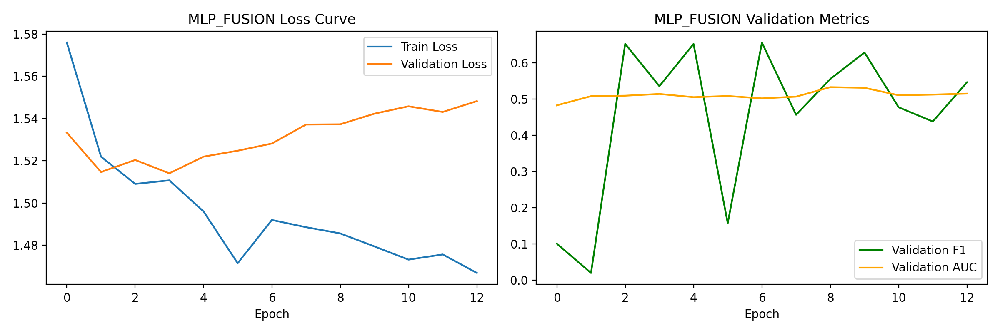 | 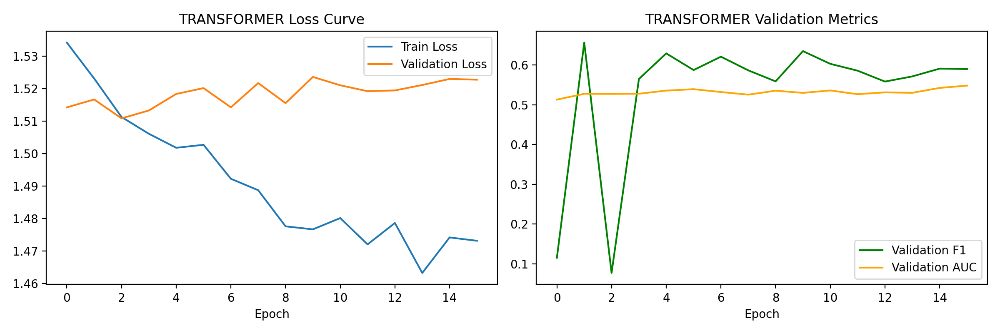 |

**特征重要性（permutation importance）**

| LSTM | GRU |
|---|---|
| 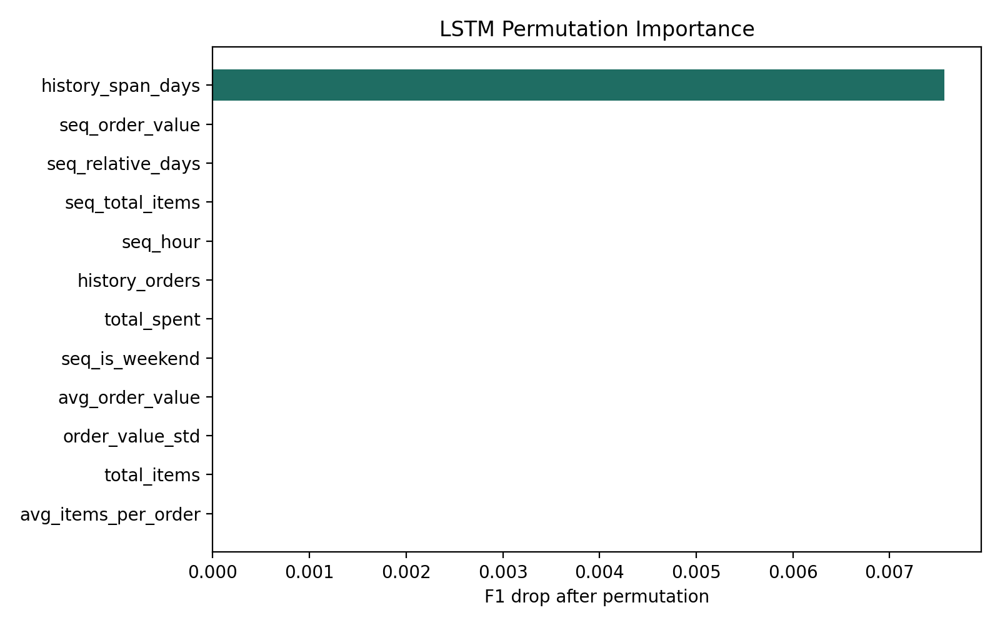 | 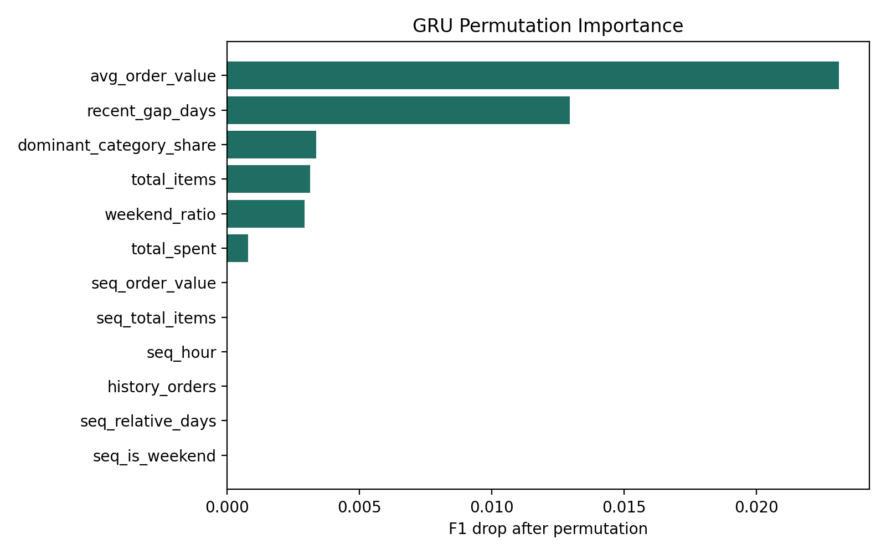 |
| 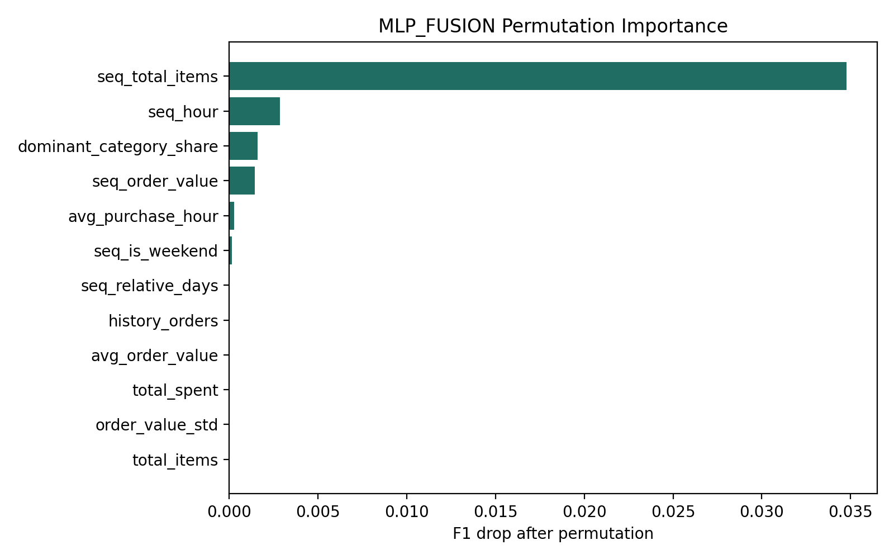 | 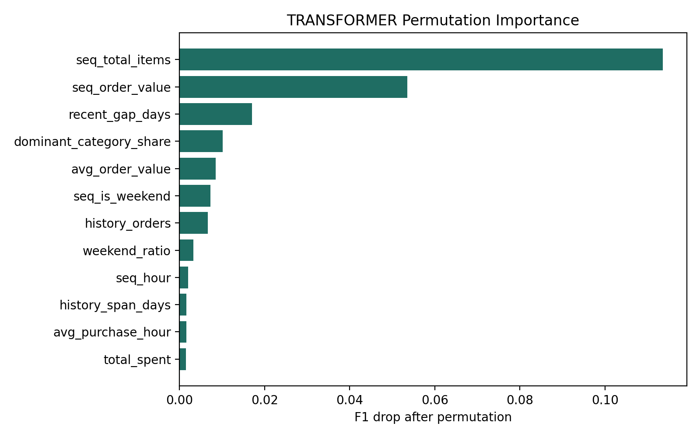 |

</details>

---

## 系统功能

| 模块 | 说明 |
|---|---|
| 用户体系 | 注册 / 登录 / 会话，密码哈希存储，预测历史按用户隔离 |
| 数据看板 | 订单量、复购率、客单价、品类分布等汇总指标 |
| 单用户预测 | 输入用户 ID → 未来 30 天购买概率 + Top 品类推荐 |
| 批量预测 | 上传用户列表 → 批量输出概率与推荐，结果可下载 |
| 模型对比 | 页面直接查看四模型指标表、ROC、混淆矩阵、训练曲线 |
| 特征重要性 | permutation importance，看哪些特征真正起作用 |
| 结果溯源 | 实验结果文件与预测记录均可回查 |

后端 Flask（`webapp.py`，12 个路由 + 登录装饰器 + 分环境报错），前端 Vue3（`static/js/app.js`），数据落 SQLite。

---

## 结构

```
src/
  data_preprocessing.py   多表合并与清洗（9 张 Olist 表）
  feature_engineering.py  用户静态画像 + 30 天时序特征构建
  feature_scaling.py      标准化与特征缓存
  models.py               4 种模型：LSTM / GRU / MLP Fusion / Transformer
  train.py                训练、早停、阈值搜索、指标保存、permutation importance
  inference.py            单用户与批量推理
webapp.py                 Flask 后端（注册登录、预测、历史、实验产物）
app.py                    Streamlit 备用演示
static/ templates/        Vue3 前端
models/                   训练好的权重（4 个）+ 特征标准化器
results/                  指标 JSON、混淆矩阵、ROC、训练曲线、特征重要性
```

---

## 快速开始

```bash
pip install -r requirements.txt

# 1. 数据准备：把 Olist 9 张 CSV 放到 data/raw/
python -m src.data_preprocessing
python -m src.feature_engineering
python -m src.feature_scaling

# 2. 训练（四模型依次跑，结果写入 results/）
python -m src.train

# 3. 起服务
python webapp.py          # Flask + Vue，默认 5000
python -m streamlit run app.py   # Streamlit 备用页
```

数据集体积较大未入库，需自行从 [Kaggle: Brazilian E-Commerce Public Dataset by Olist](https://www.kaggle.com/datasets/olistbr/brazilian-ecommerce) 下载。

---

## 环境

Python 3.10+ / PyTorch / Flask / scikit-learn / pandas / Streamlit，依赖见 `requirements.txt`。

---

## 已知限制

- 数据为 2016–2018 年巴西电商，与国内用户行为分布差异大，指标不能直接迁移
- 时序特征窗口固定 30 天，未做多窗口对照
- 未做线上服务化（无 Docker、无并发压测），Flask 为开发服务器起法
- 品类任务只有 9 类，类别 F1 极低（macro-F1 < 0.05），实用价值有限
